# 🌳 Version Control with Git for DevOps

A simple, beginner-friendly guide to Git and version control for DevOps: what each command does, why DevOps people need it, and the exact steps you can run to see it work with your own eyes.

Every topic follows the same pattern: **what it is**, **why DevOps people care**, and **something small you can try right now**. You don't need any Git or programming background to start. Read it in order, type every command yourself, and finish with the labs at the end.

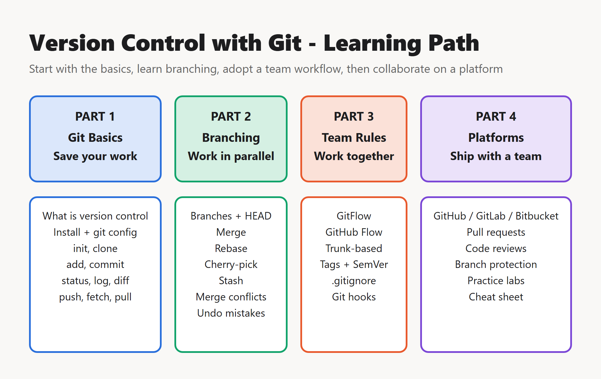

---

## 📚 Table of Contents

**PART 1: Git Basics (Save Your Work)**

1. [Start Here: Why Version Control Matters for DevOps](#1-start-here-why-version-control-matters-for-devops)
2. [What Is Version Control](#2-what-is-version-control)
3. [Install and First-Time Setup](#3-install-and-first-time-setup)
4. [The Three Areas of Git](#4-the-three-areas-of-git)
5. [git init: Start a New Repository](#5-git-init-start-a-new-repository)
6. [git clone: Copy an Existing Repository](#6-git-clone-copy-an-existing-repository)
7. [git status and git add: The Life of a File](#7-git-status-and-git-add-the-life-of-a-file)
8. [git commit: Save a Snapshot](#8-git-commit-save-a-snapshot)
9. [Looking at History: log, diff, show](#9-looking-at-history-log-diff-show)
10. [Remotes and git push](#10-remotes-and-git-push)
11. [git fetch vs git pull](#11-git-fetch-vs-git-pull)

**PART 2: Branching (Work in Parallel)**

12. [Branches and HEAD](#12-branches-and-head)
13. [Merging](#13-merging)
14. [Rebasing](#14-rebasing)
15. [Cherry-pick](#15-cherry-pick)
16. [Stash](#16-stash)
17. [Resolving Merge Conflicts](#17-resolving-merge-conflicts)
18. [Undoing Mistakes](#18-undoing-mistakes)

**PART 3: Team Rules (Work Together)**

19. [Branching Strategies: The Big Picture](#19-branching-strategies-the-big-picture)
20. [GitFlow](#20-gitflow)
21. [GitHub Flow](#21-github-flow)
22. [Trunk-Based Development](#22-trunk-based-development)
23. [Choosing a Strategy](#23-choosing-a-strategy)
24. [Tags](#24-tags)
25. [Semantic Versioning](#25-semantic-versioning)
26. [.gitignore](#26-gitignore)
27. [Git Hooks](#27-git-hooks)

**PART 4: Platforms and Collaboration (Ship With a Team)**

28. [GitHub, GitLab and Bitbucket](#28-github-gitlab-and-bitbucket)
29. [Connecting With SSH Keys](#29-connecting-with-ssh-keys)
30. [Pull Requests](#30-pull-requests)
31. [Code Reviews](#31-code-reviews)
32. [Branch Protection Rules](#32-branch-protection-rules)

**PART 5: Practice**

33. [The Daily Git Workflow](#33-the-daily-git-workflow)
34. [Practice Labs](#34-practice-labs)
35. [Cheat Sheet](#35-cheat-sheet)
36. [Interview Questions](#36-interview-questions)
37. [Reference](#37-reference)

---

# PART 1: Git Basics (Save Your Work)

---

## 1. Start Here: Why Version Control Matters for DevOps

In DevOps, **everything is code**: the application, the Dockerfile, the Kubernetes YAML, the Terraform files, the CI/CD pipeline. And everything that is code lives in Git.

Here is what goes wrong when people don't understand Git:

| What people say | What it actually is |
|-----------------|--------------------|
| "I lost a whole day of work" | They never committed, then ran `git reset --hard` or `git checkout .` |
| "My push was rejected" | Someone else pushed first. They need `git pull` before `git push` |
| "Production broke and we don't know what changed" | No small commits, no clear messages, no tags |
| "Our AWS keys got leaked on GitHub" | `.env` was committed because there was no `.gitignore` |
| "The merge took three days" | Feature branch lived for 6 weeks and drifted away from `main` |
| "Someone pushed straight to main and broke the build" | No branch protection rules |

Every one of those is a **Git problem, not a coding problem**. Git is the first tool every DevOps engineer uses every single day.

### 1.1 What you will be able to do after this guide

- Create a repository, save work with commits and push it to GitHub
- Work on features in branches and merge them safely
- Fix merge conflicts without panic
- Undo almost any mistake (yes, even "deleted" commits)
- Pick and explain a branching strategy (GitFlow, GitHub Flow, Trunk-based)
- Version releases with tags and semantic versioning
- Keep secrets out of Git with `.gitignore` and hooks
- Open pull requests, review code and protect the `main` branch

### 1.2 The 8 words you will see everywhere

| Word | Plain meaning |
|------|---------------|
| **Repository (repo)** | A project folder that Git is tracking, including its full history |
| **Commit** | A saved snapshot of your project at one moment, with a message |
| **Branch** | A separate line of work, like a parallel copy you can play with |
| **Merge** | Combining the work of one branch into another |
| **Remote** | A copy of the repo on a server, like GitHub. Usually called `origin` |
| **Push / Pull** | Send your commits up to the remote / bring the remote's commits down |
| **HEAD** | "You are here" - the commit you currently have open |
| **Pull Request (PR)** | A request to review and merge your branch into `main` |

> 💡 **Tip:** Keep a terminal open while you read. Every section has commands you can run immediately. Git only makes sense when you watch it happen.

---

## 2. What Is Version Control

**What it is:** A system that records every change to your files over time, so you can see **who** changed **what**, **when** and **why**, and go back to any earlier version.

**Why DevOps people care:** When production breaks at 2 AM, the first question is always "what changed?". Version control answers it in seconds, and lets you roll back with one command.

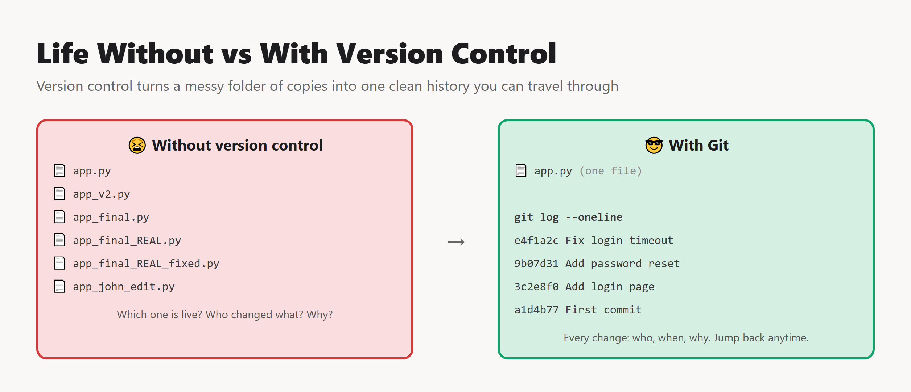

### 2.1 What version control gives you

| Superpower | Example |
|------------|---------|
| **History** | See every change ever made to `nginx.conf` |
| **Undo** | Go back to the version from last Friday |
| **Blame / audit** | Find who changed the database password and why |
| **Parallel work** | 10 people work on 10 features at the same time |
| **Backup** | Every clone is a full backup of the project |
| **Automation** | CI/CD pipelines start automatically when code is pushed |

### 2.2 Centralized vs Distributed

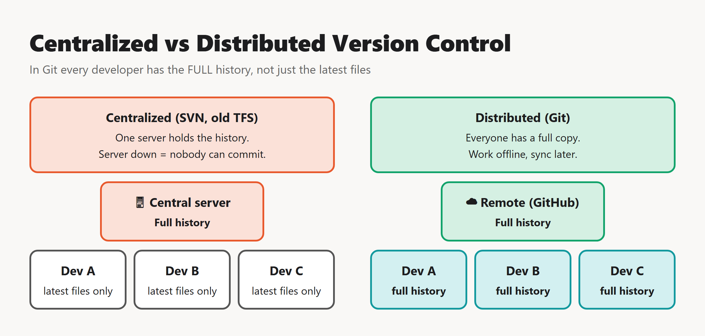

| | Centralized (SVN, Perforce, old TFS) | Distributed (Git, Mercurial) |
|--|----------------------------|------------------------------|
| Where is the history? | Only on the central server | On **every** developer's machine |
| Work offline? | ❌ No | ✅ Yes, commit anywhere |
| Server dies? | History may be lost | Any clone can restore it |
| Speed | Network for most actions | Almost everything is local and instant |

**Git** was created in 2005 by Linus Torvalds (the creator of Linux) and today it is used by almost every software team on Earth.

> 💡 **Tip:** **Git** is the tool on your computer. **GitHub / GitLab / Bitbucket** are websites that host Git repositories. You can use Git without GitHub, but not GitHub without Git.

---

## 3. Install and First-Time Setup

**What it is:** Installing Git and telling it who you are, so your name appears on your commits.

### 3.1 Install Git

| OS | Command |
|----|---------|
| **Windows** | Download from [git-scm.com](https://git-scm.com/download/win) (includes **Git Bash**) or `winget install Git.Git` |
| **macOS** | `brew install git` or `xcode-select --install` |
| **Ubuntu / Debian** | `sudo apt update && sudo apt install git -y` |
| **RHEL / Amazon Linux** | `sudo dnf install git -y` |

Check it works:

```bash
git --version
# git version 2.47.0
```

### 3.2 Tell Git who you are (do this once)

```bash
git config --global user.name  "Your Name"
git config --global user.email "you@example.com"

# Name the first branch "main" (modern default)
git config --global init.defaultBranch main

# Use VS Code as the editor for commit messages (optional)
git config --global core.editor "code --wait"

# Make 'git pull' rebase instead of creating merge commits (optional, popular)
git config --global pull.rebase true
```

See all your settings:

```bash
git config --list --show-origin
```

### 3.3 The three config levels

| Level | Flag | File | Applies to |
|-------|------|------|-----------|
| System | `--system` | `/etc/gitconfig` | Every user on the machine |
| Global | `--global` | `~/.gitconfig` | Every repo of **your** user |
| Local | `--local` (default) | `.git/config` | Only this one repo |

Local wins over global, global wins over system. Useful when you use a work email in one repo and a personal email in another.

> 💡 **Tip:** Use the **same email** as your GitHub account, otherwise GitHub won't link the commits to your profile.

---

## 4. The Three Areas of Git

**What it is:** Git keeps your work in three local places, plus the remote. Every Git command is just moving changes between these boxes.

**Why DevOps people care:** 90% of Git confusion disappears once you understand this picture. "Why didn't my change get committed?" - because it was never **staged**.

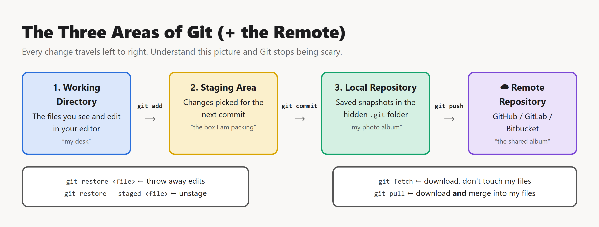

| Area | What lives there | Analogy |
|------|------------------|---------|
| **Working directory** | The real files you edit | Your desk |
| **Staging area (index)** | Changes you picked for the next commit | A box you are packing |
| **Local repository** | All commits, stored in the hidden `.git` folder | Your photo album |
| **Remote repository** | The shared copy on GitHub/GitLab/Bitbucket | The family photo album everyone can see |

Why have a staging area at all? It lets you commit **only part** of your changes. You fixed a bug and also added a feature? Stage and commit them separately so each commit has one clear purpose.

> ⚠️ **Warning:** Never edit, delete or copy files inside the `.git` folder by hand. That folder **is** your repository. Delete it and the whole history is gone.

---

## 5. git init: Start a New Repository

**What it is:** Turns any normal folder into a Git repository by creating the hidden `.git` folder.

### 5.1 Try it now

```bash
mkdir my-first-repo
cd my-first-repo
git init
# Initialized empty Git repository in /home/you/my-first-repo/.git/

ls -la
# you will see a .git folder
```

That's it. The folder is now tracked by Git. Nothing is saved yet - you still need to add and commit files.

### 5.2 What is inside .git?

```
.git/
├── HEAD          ← which branch you are on
├── config        ← this repo's settings (remotes, etc.)
├── objects/      ← every file version and commit, compressed
├── refs/heads/   ← one file per branch, holding a commit hash
└── hooks/        ← scripts that run automatically (section 27)
```

> 💡 **Tip:** Running `git init` again in the same folder is safe. It will not delete anything.

---

## 6. git clone: Copy an Existing Repository

**What it is:** Downloads a full copy of a remote repository - all files, all branches, the whole history - and sets up `origin` to point back to it.

```bash
# HTTPS (easiest to start)
git clone https://github.com/git/git.git

# SSH (best for daily work, see section 29)
git clone git@github.com:OWNER/REPO.git

# Clone into a folder with a different name
git clone https://github.com/OWNER/REPO.git my-folder

# Shallow clone: only the latest commit (fast, used in CI pipelines)
git clone --depth 1 https://github.com/OWNER/REPO.git

# Clone one specific branch
git clone --branch develop https://github.com/OWNER/REPO.git
```

After cloning:

```bash
cd REPO
git remote -v
# origin  https://github.com/OWNER/REPO.git (fetch)
# origin  https://github.com/OWNER/REPO.git (push)
```

| | `git init` | `git clone` |
|--|-----------|-------------|
| Use when | Starting a brand-new project | Joining an existing project |
| History | Empty | Full history downloaded |
| Remote | None, add it yourself | `origin` set up automatically |

> 💡 **Tip:** CI/CD systems like GitHub Actions and Jenkins use `git clone --depth 1` to save time - they only need the latest code, not 10 years of history.

---

## 7. git status and git add: The Life of a File

**What it is:** `git status` tells you the state of every file. `git add` moves changes into the staging area.

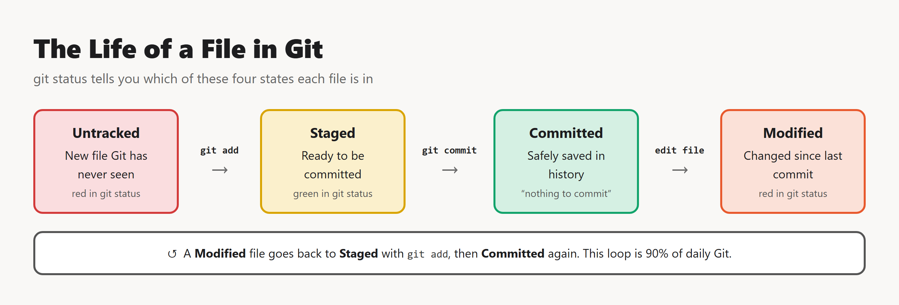

### 7.1 Try it now

```bash
echo "# My Project" > README.md
git status
```

```
On branch main
Untracked files:
  (use "git add <file>..." to include in what will be committed)
        README.md
```

```bash
git add README.md
git status
```

```
Changes to be committed:
        new file:   README.md
```

### 7.2 Different ways to add

| Command | What it stages |
|---------|----------------|
| `git add file.txt` | One file |
| `git add src/` | Everything in a folder |
| `git add .` | Everything changed in the current folder and below |
| `git add -A` | Everything changed in the whole repo (including deletions) |
| `git add -p` | **Interactive**: Git shows each change and asks y/n. The pro move |
| `git add *.yaml` | Every YAML file in the current folder |

### 7.3 Short status

```bash
git status -s
```

```
 M app.py        ← modified, not staged (M in the right column)
M  config.yaml   ← modified and staged (M in the left column)
A  new.txt       ← new file, staged
?? notes.txt     ← untracked
 D old.txt       ← deleted, not staged
```

> ⚠️ **Warning:** `git add .` adds **everything**, including `.env` files with passwords, if you have no `.gitignore`. Always run `git status` before you commit. Set up `.gitignore` first (section 26).

---

## 8. git commit: Save a Snapshot

**What it is:** Takes everything in the staging area and saves it permanently as a commit, with your name, the date and a message.

### 8.1 Try it now

```bash
git commit -m "Add README"
```

```
[main (root-commit) a1d4b77] Add README
 1 file changed, 1 insertion(+)
 create mode 100644 README.md
```

Other ways to commit:

```bash
git commit                      # opens your editor for a longer message
git commit -am "Fix typo"       # stage ALL tracked modified files + commit (skips new files!)
git commit --amend              # change the last commit (message or content)
git commit --allow-empty -m "Trigger CI"   # commit with no changes, useful to rerun a pipeline
```

### 8.2 Writing good commit messages

A commit message is a note to your teammates (and future you at 2 AM).

| ❌ Bad | ✅ Good |
|--------|---------|
| `fix` | `Fix login timeout when token expires` |
| `changes` | `Add health check endpoint for load balancer` |
| `asdfgh` | `Bump nginx image from 1.25 to 1.27` |
| `final version` | `Remove unused Terraform S3 bucket` |

**The rules:**

1. Summary line under ~50-72 characters
2. Use the imperative mood: "Add", "Fix", "Remove" (as if finishing the sentence *"This commit will…"*)
3. Explain **why** in the body, not just what
4. One logical change per commit

### 8.3 Conventional Commits (used by many DevOps teams)

```
<type>(optional scope): <summary>

feat(auth): add password reset email
fix(api): return 404 instead of 500 for missing user
docs: explain how to run locally
ci: cache npm packages in pipeline
chore(deps): bump express to 4.21.0
feat!: drop support for Node 16      ← "!" means BREAKING change
```

| Type | Use for | Version bump (section 25) |
|------|---------|--------------------------|
| `feat` | A new feature | MINOR |
| `fix` | A bug fix | PATCH |
| `feat!` / `BREAKING CHANGE:` | Breaking change | MAJOR |
| `docs`, `style`, `refactor`, `test`, `ci`, `chore`, `build`, `perf` | Everything else | none |

Tools like **semantic-release** read these messages and create version numbers and changelogs **automatically**. That's why DevOps teams love them.

> 💡 **Tip:** A hook that enforces this format is in [`examples/hooks/commit-msg`](examples/hooks/commit-msg).

---

## 9. Looking at History: log, diff, show

**What it is:** Commands that let you read the story of your project.

### 9.1 git log

```bash
git log                          # full details
git log --oneline                # one line per commit
git log --oneline --graph --all  # draw branches as ASCII art  ⭐
git log -5                       # last 5 commits
git log --author="Kanishka"      # commits by one person
git log --since="2 weeks ago"
git log -- nginx.conf            # history of one file
git log -S "password"            # commits that added or removed the word "password"
```

Example of `git log --oneline --graph --all`:

```
* e4f1a2c (HEAD -> main, origin/main) Fix login timeout
*   9b07d31 Merge branch 'feature/reset'
|\
| * 7a2c1d0 Add password reset
|/
* 3c2e8f0 Add login page
* a1d4b77 Add README
```

### 9.2 git diff

```bash
git diff                   # working dir vs staging   (what you have NOT staged yet)
git diff --staged          # staging vs last commit   (what WILL be committed)
git diff main..feature     # compare two branches
git diff HEAD~3 HEAD       # what changed in the last 3 commits
git diff --stat            # only file names and line counts
```

Reading a diff:

```diff
--- a/app.py
+++ b/app.py
@@ -10,3 +10,3 @@
 def greet():
-    return "Hello"
+    return "Hello, DevOps!"
```

Lines starting with `-` were removed, `+` were added.

### 9.3 git show and git blame

```bash
git show e4f1a2c        # what one commit changed
git show HEAD~1:app.py  # app.py as it was one commit ago
git blame app.py        # who last changed each line, and in which commit
```

> 💡 **Tip:** `HEAD~1` means "one commit before HEAD", `HEAD~2` is two before, and so on. You will use this a lot.

---

## 10. Remotes and git push

**What it is:** A **remote** is a named link to another copy of the repo (usually on GitHub). `git push` sends your local commits to it.

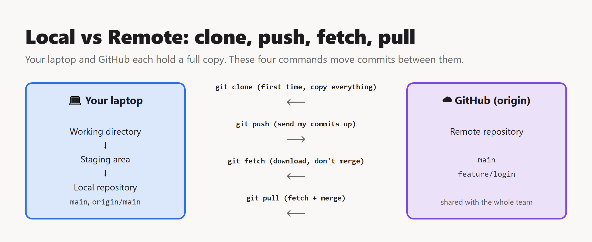

### 10.1 Connect a local repo to GitHub

1. Create an **empty** repository on GitHub (no README, no .gitignore).
2. Then:

```bash
git remote add origin https://github.com/YOUR-USER/my-first-repo.git
git branch -M main
git push -u origin main
```

`-u` (or `--set-upstream`) links your local `main` to `origin/main`, so next time you just type `git push` or `git pull`.

### 10.2 Remote commands

```bash
git remote -v                              # list remotes
git remote add upstream <url>              # add a second remote (e.g. original repo of a fork)
git remote set-url origin <new-url>        # change the URL (e.g. HTTPS → SSH)
git remote remove upstream
git push origin feature/login              # push a branch
git push origin --delete feature/login     # delete a remote branch
git push --tags                            # push all tags
```

### 10.3 "Push rejected"? Don't panic

```
! [rejected]        main -> main (fetch first)
error: failed to push some refs
hint: Updates were rejected because the remote contains work that you do not have locally.
```

It just means someone pushed before you. Fix:

```bash
git pull --rebase    # get their commits, put yours on top
git push
```

> ⚠️ **Warning:** **Never** use `git push --force` on a shared branch like `main`. It overwrites your teammates' work. If you really must force push your own branch, use the safer `git push --force-with-lease` - it refuses if someone else pushed in the meantime.

---

## 11. git fetch vs git pull

**What it is:** Both download new commits from the remote. The difference is whether they touch your files.

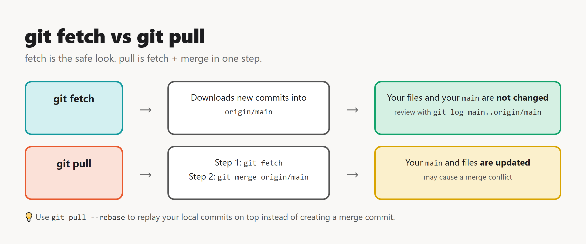

| | `git fetch` | `git pull` |
|--|-------------|-----------|
| Downloads new commits | ✅ | ✅ |
| Updates `origin/main` | ✅ | ✅ |
| Changes your `main` and your files | ❌ | ✅ (merge or rebase) |
| Can cause merge conflicts | ❌ Never | ✅ Yes |
| Safe to run anytime | ✅ Always | Mostly |

### 11.1 Try it

```bash
git fetch origin
git log --oneline main..origin/main    # commits on the remote you don't have yet
git diff main origin/main              # what they changed
git merge origin/main                  # happy? bring them in
```

That's exactly what `git pull` does in one step.

```bash
git pull                 # fetch + merge
git pull --rebase        # fetch + rebase (cleaner, straight history)
git fetch --prune        # also delete local references to branches removed on the remote
```

> 💡 **Tip:** When in doubt, `fetch` first and look. `pull` is `fetch` + `merge` without a chance to look.

---

# PART 2: Branching (Work in Parallel)

---

## 12. Branches and HEAD

**What it is:** A branch is a **movable label that points to a commit**. That's all. Creating a branch costs nothing - it is a 41-byte file.

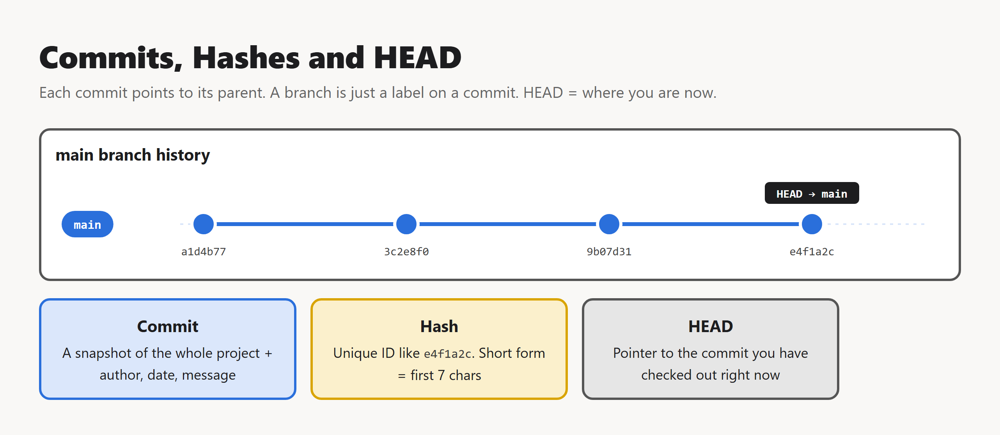

**Why DevOps people care:** Branches let you build a feature, test a config change or try a Terraform upgrade **without touching what is deployed**. Every pipeline you build will trigger on branches.

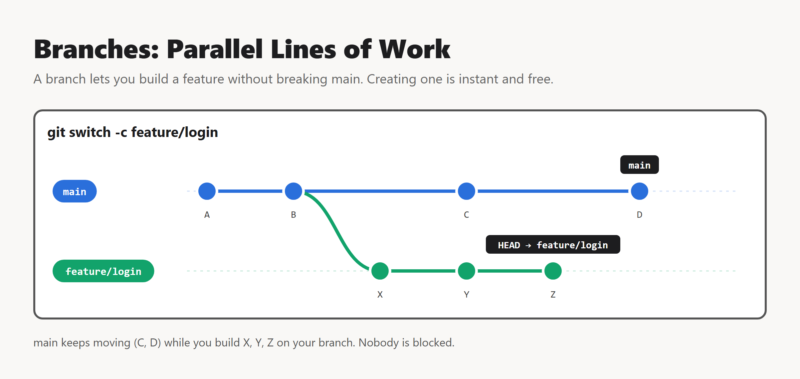

### 12.1 Try it now

```bash
git branch                       # list local branches (* = current)
git branch -a                    # include remote branches
git switch -c feature/login      # create AND switch to a new branch  ⭐
git switch main                  # switch back
git branch -d feature/login      # delete (only if merged)
git branch -D feature/login      # force delete (even if not merged)
git branch -m old-name new-name  # rename
```

> 💡 **Tip:** `git switch` (Git 2.23+) is the modern command. In older tutorials you will see `git checkout -b feature/login` and `git checkout main` - they do the same thing.

### 12.2 Naming branches

| Prefix | Example | Use for |
|--------|---------|---------|
| `feature/` | `feature/user-login` | New features |
| `fix/` or `bugfix/` | `fix/null-pointer-on-logout` | Bug fixes |
| `hotfix/` | `hotfix/1.4.1-payment-crash` | Urgent production fixes |
| `release/` | `release/2.0.0` | Preparing a release |
| `chore/` | `chore/upgrade-node-22` | Maintenance |
| `docs/` | `docs/install-guide` | Documentation |

Add the ticket number if your team uses Jira: `feature/DEV-142-user-login`.

### 12.3 Detached HEAD

If you `git switch --detach a1d4b77` (or `git checkout a1d4b77`), HEAD points straight at a commit, not a branch. You can look around, but commits you make there belong to no branch. To keep them:

```bash
git switch -c rescue-branch
```

---

## 13. Merging

**What it is:** `git merge` takes the commits from another branch and combines them into your current branch.

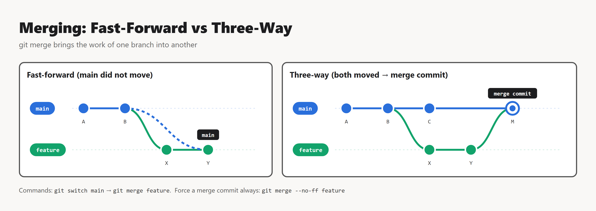

### 13.1 Try it now

```bash
git switch -c feature/hello
echo "hello" > hello.txt
git add hello.txt && git commit -m "Add hello file"

git switch main
git merge feature/hello
```

### 13.2 The two kinds of merge

| Type | When it happens | Result |
|------|-----------------|--------|
| **Fast-forward** | `main` has no new commits since you branched | Git just moves the `main` label forward. No new commit |
| **Three-way merge** | Both branches have new commits | Git creates a new **merge commit** with two parents |

```bash
git merge --no-ff feature/hello   # always create a merge commit (keeps the branch visible in history)
git merge --squash feature/hello  # squash all branch commits into ONE staged change, then you commit
git merge --abort                 # cancel a merge that has conflicts
```

### 13.3 PR merge buttons (GitHub/GitLab/Bitbucket)

| Button | What it does | History looks like |
|--------|-------------|-------------------|
| **Merge commit** | `--no-ff` merge | All commits + a merge commit |
| **Squash and merge** | All commits become one | One clean commit per PR ⭐ popular |
| **Rebase and merge** | Replays each commit on top of main | Straight line, all commits kept |

---

## 14. Rebasing

**What it is:** `git rebase` takes your branch's commits and **replays them on top of** another branch, as if you had started your work from there.

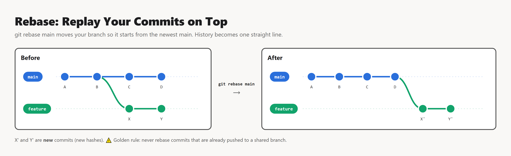

**Why DevOps people care:** It keeps history as one straight line that is easy to read and easy to `git bisect` when hunting for the commit that broke production.

### 14.1 Try it

```bash
git switch feature/login
git fetch origin
git rebase origin/main
# if there's a conflict: fix the file, git add <file>, then
git rebase --continue
# or give up and go back:
git rebase --abort
```

### 14.2 Merge vs Rebase

| | Merge | Rebase |
|--|-------|--------|
| History | True history, with merge commits | Clean straight line |
| Rewrites commits? | ❌ No | ✅ Yes (new hashes) |
| Safe on shared branches? | ✅ Yes | ❌ No |
| Conflicts | Fixed once | May be fixed per commit |

### 14.3 Interactive rebase: clean up before a PR

```bash
git rebase -i HEAD~4
```

Your editor opens:

```
pick 3c2e8f0 Add login page
pick 7a2c1d0 wip
pick 9b07d31 fix typo
pick e4f1a2c Add login tests

# p = pick, r = reword, s = squash (merge into previous), f = fixup (squash, drop message), d = drop
```

Change `wip` and `fix typo` to `f`, save, and 4 messy commits become 2 clean ones.

> ⚠️ **Warning - the Golden Rule of Rebasing:** **Never rebase commits that other people already have** (anything pushed to `main`, `develop` or a shared branch). Rebasing creates new commits, and your teammates' history will no longer match. Rebasing your own feature branch before opening a PR is fine.

---

## 15. Cherry-pick

**What it is:** Copies **one specific commit** from anywhere and applies it to your current branch as a new commit.

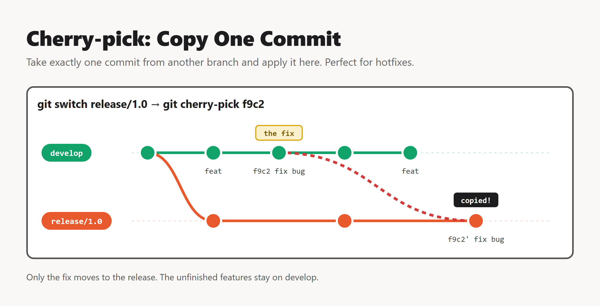

**Why DevOps people care:** A bug fix landed on `develop`, but release `1.0` (in production) needs it today - without all the unfinished features on `develop`. Cherry-pick just the fix.

```bash
git log --oneline develop          # find the hash, e.g. f9c2a10
git switch release/1.0
git cherry-pick f9c2a10
git cherry-pick f9c2a10 b81d3e4    # several commits
git cherry-pick A^..B              # a range, A through B
git cherry-pick -x f9c2a10         # add "(cherry picked from commit ...)" to the message ⭐
git cherry-pick --abort            # cancel if conflicts get messy
```

> 💡 **Tip:** Use `-x` so later you can see where the commit came from. Don't overuse cherry-pick - the same change living as two different commits can confuse future merges.

---

## 16. Stash

**What it is:** A drawer where Git temporarily keeps your **uncommitted** changes, giving you a clean working directory.

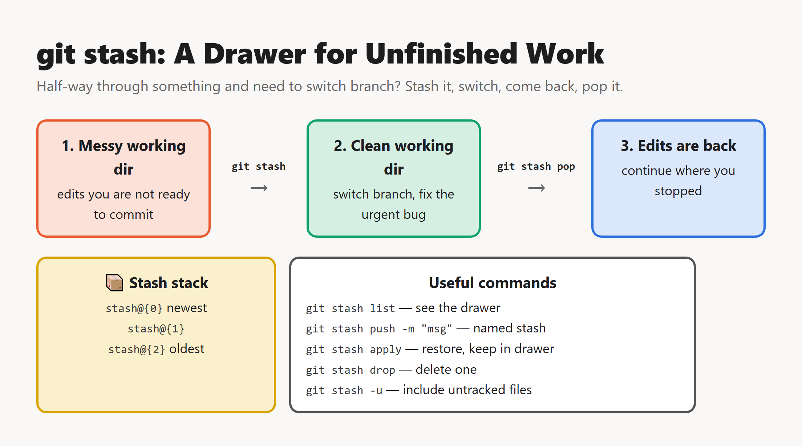

**Why DevOps people care:** You are half-way through a pipeline change and production breaks. You need to switch to `main` *now*, but your work isn't ready to commit.

### 16.1 Try it

```bash
echo "half done" >> app.py
git stash push -m "WIP pipeline cache"   # save and clean
git status                               # clean!
git switch main                          # go fix the urgent thing
# ...fix, commit, push...
git switch feature/pipeline
git stash pop                            # changes are back
```

| Command | What it does |
|---------|-------------|
| `git stash` | Stash tracked changes |
| `git stash -u` | Also stash **untracked** (new) files |
| `git stash list` | Show all stashes |
| `git stash show -p stash@{1}` | See what is inside one |
| `git stash pop` | Apply the newest stash **and remove it** |
| `git stash apply stash@{1}` | Apply but keep it in the list |
| `git stash drop stash@{1}` | Delete one |
| `git stash branch new-branch` | Create a branch from a stash |
| `git stash clear` | Delete all (careful!) |

> ⚠️ **Warning:** Stashes are local only - they are never pushed. Don't leave important work in a stash for weeks. Commit it to a branch instead.

---

## 17. Resolving Merge Conflicts

**What it is:** When two branches change **the same lines** of the same file, Git cannot decide which to keep. It stops and asks you.

**Why DevOps people care:** Conflicts happen weekly in any team. Engineers who can fix them calmly are worth their weight in gold.

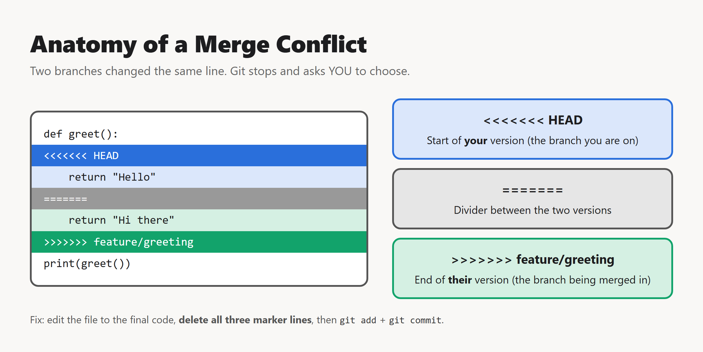

### 17.1 Create a conflict on purpose (try it!)

```bash
mkdir conflict-lab && cd conflict-lab && git init
echo 'greeting = "Hello"' > app.py
git add . && git commit -m "Initial"

git switch -c feature/greeting
echo 'greeting = "Hi there"' > app.py
git commit -am "Friendlier greeting"

git switch main
echo 'greeting = "Good morning"' > app.py
git commit -am "Morning greeting"

git merge feature/greeting
# CONFLICT (content): Merge conflict in app.py
# Automatic merge failed; fix conflicts and then commit the result.
```

### 17.2 Fix it step by step

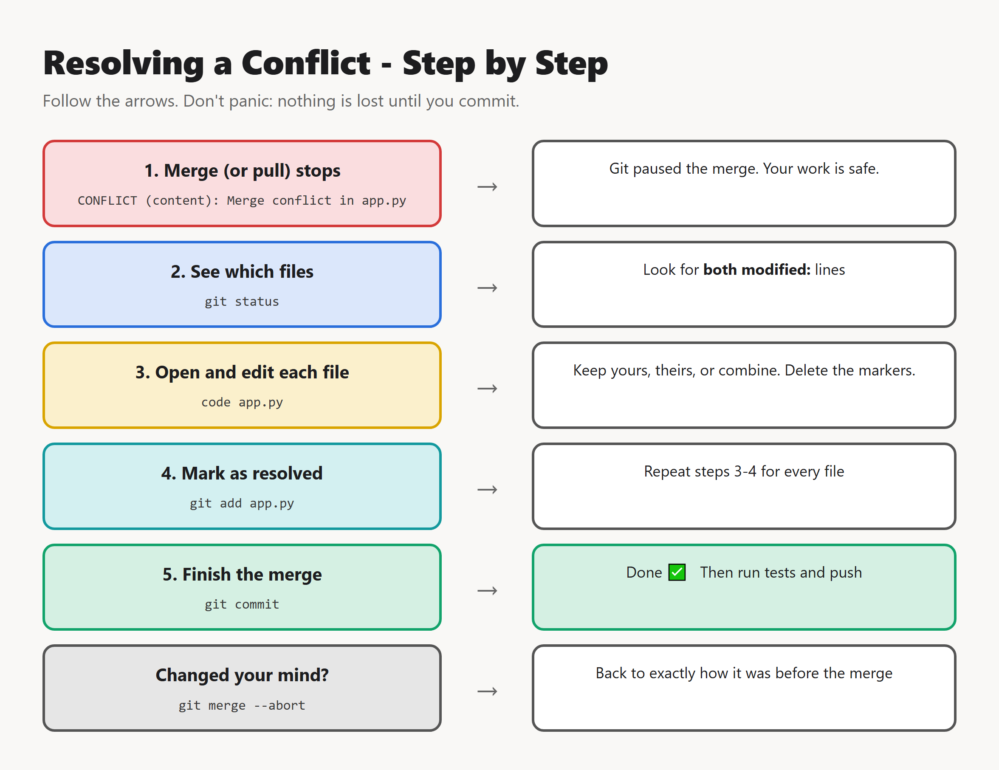

```bash
git status
# both modified:   app.py

cat app.py
# <<<<<<< HEAD
# greeting = "Good morning"
# =======
# greeting = "Hi there"
# >>>>>>> feature/greeting
```

Edit the file to what you actually want, and **delete all three marker lines**:

```python
greeting = "Hi there, good morning"
```

```bash
git add app.py
git commit            # Git pre-fills a merge message
git log --oneline --graph
```

### 17.3 Shortcuts

```bash
git checkout --ours   app.py   # keep MY version (the branch I'm on)
git checkout --theirs app.py   # keep THEIR version (the branch coming in)
git merge --abort              # cancel everything, back to before the merge
git mergetool                  # open a visual merge tool
git diff --name-only --diff-filter=U   # list only conflicted files
```

> ⚠️ **Warning:** During a **rebase**, `ours` and `theirs` are swapped! `ours` = the branch you are rebasing onto, `theirs` = your commits. Many people get burned by this.

### 17.4 How to get fewer conflicts

- Pull/rebase from `main` **often** (daily)
- Keep branches **small and short-lived**
- Don't reformat whole files in the same PR as a logic change
- Talk to your team when you touch shared files (pipelines, configs)

> 💡 **Tip:** VS Code shows conflicts with buttons: **Accept Current**, **Accept Incoming**, **Accept Both**. Great for beginners.

---

## 18. Undoing Mistakes

**What it is:** Git can undo almost anything - as long as you committed it at some point.

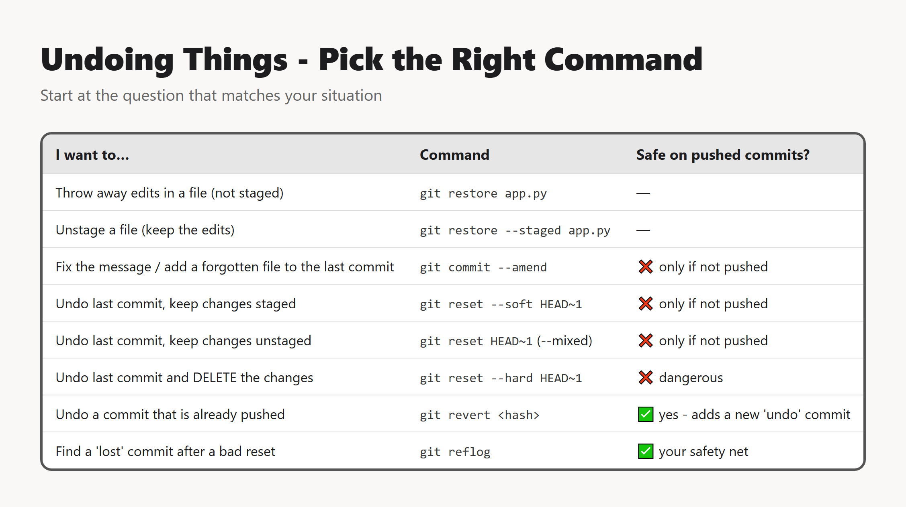

### 18.1 reset vs revert

| | `git reset` | `git revert` |
|--|-------------|--------------|
| How | Moves the branch label backwards | Creates a **new** commit that does the opposite |
| History | Rewritten (commits disappear) | Preserved |
| Use on pushed/shared commits? | ❌ No | ✅ Yes |
| Typical use | Clean up local mistakes | Roll back a bad deploy on `main` |

```bash
git revert e4f1a2c              # undo one commit safely
git revert -m 1 9b07d31         # undo a merge commit (keep parent 1 = main)
```

### 18.2 The three reset modes

```bash
git reset --soft  HEAD~1   # undo commit, changes stay STAGED
git reset --mixed HEAD~1   # undo commit, changes stay in files (default)
git reset --hard  HEAD~1   # undo commit, changes are DELETED ⚠️
```

### 18.3 git reflog: your safety net

`reflog` records **every place HEAD has been**, even commits you "deleted" with `reset --hard`.

```bash
git reflog
# e4f1a2c HEAD@{0}: reset: moving to HEAD~1
# 7b3d9f1 HEAD@{1}: commit: The work I thought I lost
git reset --hard 7b3d9f1     # it's back!
```

> 💡 **Tip:** Reflog entries are kept for about 90 days. Uncommitted changes are **not** in the reflog - commit often!

---

# PART 3: Team Rules (Work Together)

---

## 19. Branching Strategies: The Big Picture

**What it is:** A branching strategy is a team agreement: which branches exist, how long they live, where features go and how releases happen.

**Why DevOps people care:** Your CI/CD pipeline is built **around** the branching strategy. "Deploy to staging when `develop` changes, to production when a tag is pushed" - that's a strategy written in YAML.

The three you must know:

| Strategy | One-line summary |
|----------|------------------|
| **GitFlow** | Many branch types, planned versioned releases |
| **GitHub Flow** | `main` + short feature branches + PRs, deploy after merge |
| **Trunk-Based** | Everyone commits to `main` daily, feature flags hide unfinished work |

---

## 20. GitFlow

**What it is:** A strict model (by Vincent Driessen, 2010) with two permanent branches and three types of temporary branches.

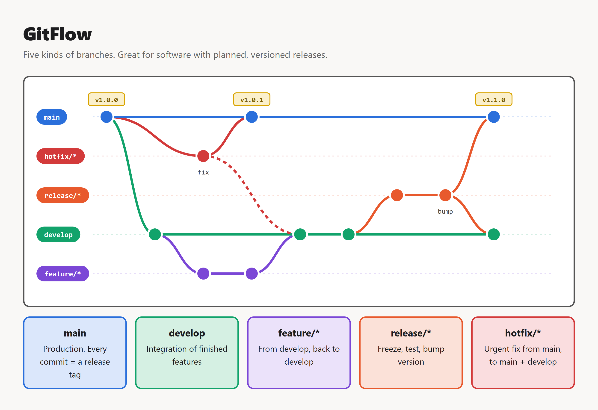

| Branch | Created from | Merged into | Lives |
|--------|-------------|-------------|-------|
| `main` | - | - | Forever. Only production releases, each one tagged |
| `develop` | `main` | - | Forever. Next release being built |
| `feature/*` | `develop` | `develop` | Until the feature is done |
| `release/*` | `develop` | `main` **and** `develop` | Until the release ships |
| `hotfix/*` | `main` | `main` **and** `develop` | Until the fix ships |

### 20.1 A release, step by step

```bash
# feature work
git switch develop
git switch -c feature/payment
# ...commits...
git switch develop && git merge --no-ff feature/payment

# prepare a release
git switch -c release/1.1.0 develop
# bump version, fix small bugs only
git switch main && git merge --no-ff release/1.1.0
git tag -a v1.1.0 -m "Release 1.1.0"
git switch develop && git merge --no-ff release/1.1.0
git branch -d release/1.1.0

# urgent production fix
git switch -c hotfix/1.1.1 main
# ...fix...
git switch main && git merge --no-ff hotfix/1.1.1 && git tag -a v1.1.1 -m "Hotfix"
git switch develop && git merge --no-ff hotfix/1.1.1
```

| ✅ Good for | ❌ Not great for |
|-------------|-----------------|
| Mobile/desktop apps with app-store releases | Web apps deployed many times a day |
| Supporting several versions (1.x and 2.x) | Small teams wanting speed |
| Teams with a QA phase before each release | Teams practicing continuous deployment |

> 💡 **Tip:** Even its author now recommends simpler flows for web apps that deploy continuously. Know GitFlow for interviews and legacy projects.

---

## 21. GitHub Flow

**What it is:** The simplest popular strategy. One rule: **`main` is always deployable.**

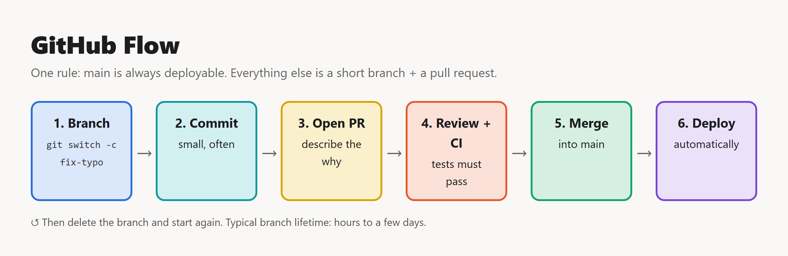

### 21.1 The steps

```bash
git switch main && git pull
git switch -c fix/login-redirect
# edit, commit, commit...
git push -u origin fix/login-redirect
# open a PR on GitHub → CI runs → teammate reviews → merge → deploy → delete branch
```

| ✅ Pros | ❌ Cons |
|---------|---------|
| Very simple to learn | No place for "release candidates" |
| Fast feedback, small PRs | Needs good automated tests |
| Fits CI/CD perfectly | Hard to maintain several versions at once |

GitLab has a similar model called **GitLab Flow**, which adds environment branches (`staging`, `production`) for teams that need them.

---

## 22. Trunk-Based Development

**What it is:** Everyone integrates into one branch (`main`, the **trunk**) at least once a day. Branches, if used at all, live less than a day or two.

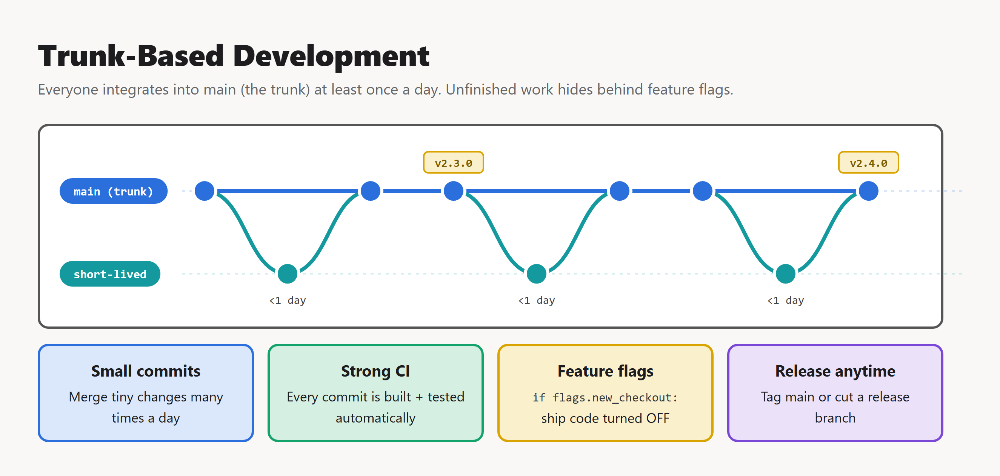

**Why DevOps people care:** It is the strategy behind **Continuous Integration** in its true meaning, and the one used by the highest-performing teams in the DORA research.

### 22.1 How do you merge unfinished features? Feature flags

```python
if feature_flags.is_enabled("new_checkout"):
    show_new_checkout()
else:
    show_old_checkout()
```

The code ships to production **switched off**. When it's ready, flip the flag - no deploy needed. If it breaks, flip it back.

### 22.2 What you need for it to work

- Fast, reliable automated tests on every commit
- Small changes (a few hours of work each)
- Feature flags (LaunchDarkly, Unleash, Flagsmith, or a simple config file)
- Code review that happens within hours, not days

---

## 23. Choosing a Strategy

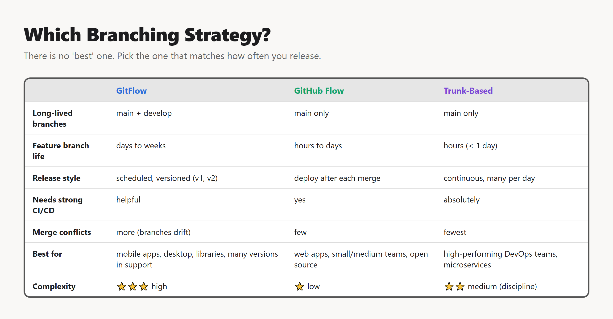

**A simple rule of thumb:**

```
Do you need to support several released versions at once (v1.x and v2.x)?
├── Yes → GitFlow (or release branches)
└── No  → Do you have strong automated tests and CI/CD?
          ├── Yes, and the team is experienced → Trunk-Based
          └── Getting there                    → GitHub Flow  ⭐ best place to start
```

---

## 24. Tags

**What it is:** A tag is a **permanent name for one commit**, usually a release like `v1.4.0`. Unlike a branch, a tag never moves.

**Why DevOps people care:** Pipelines are commonly set to **deploy to production when a tag is pushed**. Docker images get the same version as the tag. Rollback = redeploy the previous tag.

### 24.1 Two kinds of tags

| | Lightweight | Annotated ⭐ |
|--|-------------|-------------|
| Command | `git tag v1.0.0` | `git tag -a v1.0.0 -m "First release"` |
| Stores | Just a pointer | Tagger name, date, message (can be signed) |
| Use for | Private/temporary markers | Releases |

### 24.2 Try it

```bash
git tag -a v1.0.0 -m "First stable release"
git tag                          # list tags
git tag -l "v1.*"                # filter
git show v1.0.0                  # details
git tag -a v0.9.0 a1d4b77 -m "Tag an older commit"

git push origin v1.0.0           # tags are NOT pushed by default!
git push origin --tags           # push all tags

git tag -d v1.0.0                # delete locally
git push origin --delete v1.0.0  # delete on remote

git switch --detach v1.0.0       # look at the code as it was in v1.0.0
```

### 24.3 Tag-triggered pipeline (GitHub Actions example)

```yaml
on:
  push:
    tags:
      - "v*.*.*"
jobs:
  release:
    runs-on: ubuntu-latest
    steps:
      - uses: actions/checkout@v4
      - run: docker build -t myapp:${{ github.ref_name }} .
```

> ⚠️ **Warning:** Never move or reuse a published tag. Someone may already have deployed `v1.0.0`. If it's wrong, release `v1.0.1`.

---

## 25. Semantic Versioning

**What it is:** A rule for version numbers: **MAJOR.MINOR.PATCH**. The number itself tells users how risky an upgrade is. Full spec: [semver.org](https://semver.org).

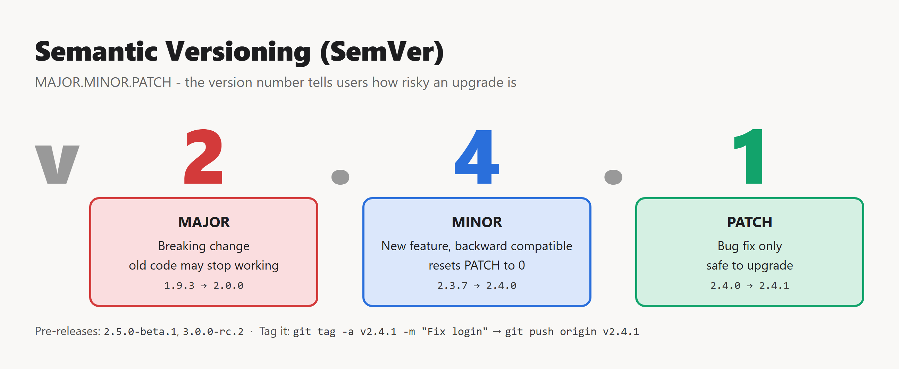

| You changed… | Bump | Example |
|-------------|------|---------|
| Something that breaks existing users (removed an API, renamed a config key) | **MAJOR** | `1.9.3 → 2.0.0` |
| Added a feature in a backward-compatible way | **MINOR** | `2.3.7 → 2.4.0` |
| Fixed a bug, nothing new | **PATCH** | `2.4.0 → 2.4.1` |

**Extra rules:**

- When you bump MAJOR, reset MINOR and PATCH to 0. When you bump MINOR, reset PATCH.
- `0.y.z` = early development, anything can change.
- Pre-releases: `2.0.0-alpha.1` → `2.0.0-beta.1` → `2.0.0-rc.1` → `2.0.0`
- Build info after `+`: `1.4.0+build.512` (ignored when comparing versions)

### 25.1 Version ranges you'll meet (npm example)

| Range | Means | Allows |
|-------|-------|--------|
| `1.4.2` | exactly | `1.4.2` only |
| `~1.4.2` | patch updates | `1.4.x` |
| `^1.4.2` | minor + patch updates | `1.x.x` (not 2.0.0) |

> 💡 **Tip:** Combine **Conventional Commits** (section 8.3) + **semantic-release** or **release-please** and your pipeline will calculate the next version, tag it and write the changelog for you.

---

## 26. .gitignore

**What it is:** A text file in your repo that lists files and folders Git should **never track**.

**Why DevOps people care:** Leaked secrets on GitHub are found by bots within **minutes**. `.gitignore` is your first line of defense - plus it keeps the repo small and clean.

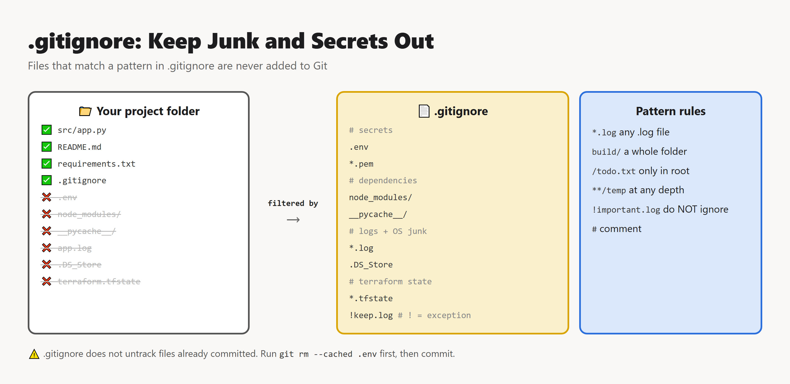

### 26.1 Try it

```bash
cat > .gitignore << 'EOF'
.env
*.log
node_modules/
.terraform/
*.tfstate
EOF

touch .env app.log
git status           # .env and app.log do NOT appear
git check-ignore -v app.log
# .gitignore:2:*.log    app.log
```

### 26.2 Pattern cheat sheet

| Pattern | Matches |
|---------|---------|
| `secret.txt` | Any file named `secret.txt`, anywhere |
| `/secret.txt` | Only in the repo root |
| `*.log` | Every `.log` file |
| `logs/` | The folder `logs` and everything inside |
| `**/cache` | `cache` at any depth |
| `docs/*.pdf` | PDFs directly in `docs/` (not subfolders) |
| `!keep.log` | Exception: do **not** ignore this one |
| `# comment` | A comment |

### 26.3 Already committed a file by mistake?

`.gitignore` only affects **untracked** files. To stop tracking something already committed:

```bash
echo ".env" >> .gitignore
git rm --cached .env       # remove from Git, keep the file on disk
git commit -m "Stop tracking .env"
```

> ⚠️ **Warning:** If you pushed a secret, removing it in a new commit is **not enough** - it is still in history. **Rotate the secret immediately** (create a new key, revoke the old one). Then clean history with `git filter-repo` or BFG if needed.

### 26.4 Ready-made templates

- [github/gitignore](https://github.com/github/gitignore) - official templates for every language
- [gitignore.io](https://www.toptal.com/developers/gitignore) - generate one for "Node, Terraform, VisualStudioCode"
- A DevOps starter is in [`examples/sample.gitignore`](examples/sample.gitignore)

A global ignore for your own OS/editor junk:

```bash
git config --global core.excludesFile ~/.gitignore_global
```

---

## 27. Git Hooks

**What it is:** Scripts that Git runs **automatically** at certain moments (before a commit, before a push, etc.). If the script exits with a non-zero code, Git **stops** the action.

**Why DevOps people care:** Hooks catch problems **before** they reach CI: secrets, lint errors, bad commit messages, broken tests. Shift-left in its simplest form.

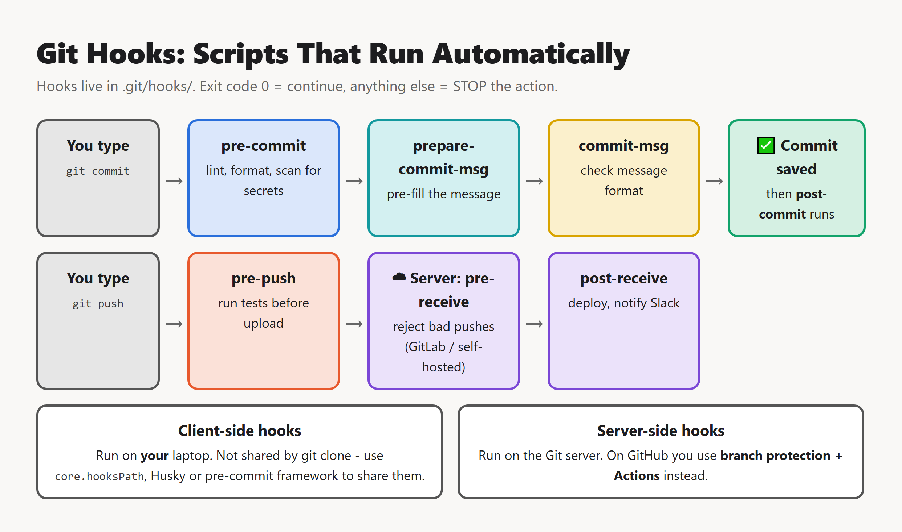

### 27.1 The most useful hooks

| Hook | Runs | Typical use |
|------|------|-------------|
| `pre-commit` | Before a commit is created | Lint, format, block secrets/large files |
| `prepare-commit-msg` | Before the message editor opens | Add the ticket number from the branch name |
| `commit-msg` | After you write the message | Enforce Conventional Commits |
| `post-commit` | After the commit | Notifications |
| `pre-push` | Before pushing | Run tests |
| `pre-receive` (server) | When the server receives a push | Reject pushes that break rules |
| `post-receive` (server) | After the server accepts a push | Trigger deploys, notify chat |

### 27.2 Try it: your first hook

```bash
cat > .git/hooks/pre-commit << 'EOF'
#!/bin/sh
if git diff --cached --name-only | grep -q "\.env$"; then
  echo "❌ You are trying to commit a .env file. Stopped."
  exit 1
fi
EOF
chmod +x .git/hooks/pre-commit

touch .env && git add -f .env && git commit -m "test"
# ❌ You are trying to commit a .env file. Stopped.
git restore --staged .env
```

Ready-to-use hooks in this repo:

- [`examples/hooks/pre-commit`](examples/hooks/pre-commit) - blocks secret files, secret-looking text and files over 5 MB
- [`examples/hooks/commit-msg`](examples/hooks/commit-msg) - enforces Conventional Commit messages

### 27.3 Sharing hooks with your team

`.git/hooks/` is **not** committed or cloned. To share hooks:

```bash
# Option 1: keep hooks in a committed folder and point Git at it
mkdir .githooks && cp examples/hooks/* .githooks/
git config core.hooksPath .githooks
```

| Tool | Ecosystem |
|------|-----------|
| [pre-commit](https://pre-commit.com) | Any language (Python-based), huge library of hooks ⭐ |
| [Husky](https://typicode.github.io/husky/) | Node.js projects |
| [Lefthook](https://github.com/evilmartians/lefthook) | Any language, fast (Go) |

Example `.pre-commit-config.yaml`:

```yaml
repos:
  - repo: https://github.com/pre-commit/pre-commit-hooks
    rev: v5.0.0
    hooks:
      - id: trailing-whitespace
      - id: check-yaml
      - id: check-added-large-files
      - id: detect-private-key
  - repo: https://github.com/gitleaks/gitleaks
    rev: v8.21.2
    hooks:
      - id: gitleaks
```

```bash
pip install pre-commit
pre-commit install          # installs the hook into .git/hooks
pre-commit run --all-files  # run on everything once
```

> ⚠️ **Warning:** Client hooks can be skipped with `git commit --no-verify`. They are a convenience, not security. Real enforcement belongs in CI and branch protection (section 32).

---

# PART 4: Platforms and Collaboration (Ship With a Team)

---

## 28. GitHub, GitLab and Bitbucket

**What it is:** Websites that host your Git repositories and add collaboration tools: pull requests, issues, CI/CD, permissions.

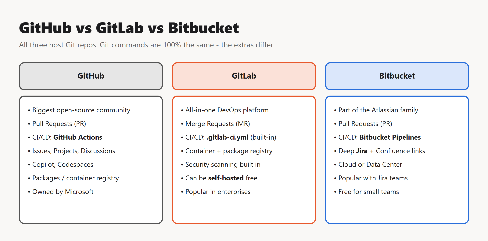

| Feature | GitHub | GitLab | Bitbucket |
|---------|--------|--------|-----------|
| Review request is called | Pull Request (PR) | **Merge Request (MR)** | Pull Request (PR) |
| Built-in CI/CD | GitHub Actions | GitLab CI/CD | Bitbucket Pipelines |
| Pipeline file | `.github/workflows/*.yml` | `.gitlab-ci.yml` | `bitbucket-pipelines.yml` |
| Self-hosted option | GitHub Enterprise Server | GitLab CE (free) / EE | Bitbucket Data Center |
| Issue tracking | GitHub Issues + Projects | GitLab Issues + Boards | Jira (deep integration) |
| Best known for | Open source, biggest community | All-in-one DevOps platform | Atlassian/Jira teams |

**The good news:** the Git commands are **exactly the same** on all three. Only the web UI and the CI file differ.

> 💡 **Tip:** Many companies mirror repos between platforms. Learn one well and the others take an afternoon.

---

## 29. Connecting With SSH Keys

**What it is:** Instead of typing a password/token on every push, you prove who you are with a key pair. The **private key** stays on your laptop, the **public key** goes to GitHub.

### 29.1 Try it

```bash
# 1. Create a key (press Enter for the defaults, set a passphrase)
ssh-keygen -t ed25519 -C "you@example.com"

# 2. Start the agent and add the key
eval "$(ssh-agent -s)"
ssh-add ~/.ssh/id_ed25519

# 3. Copy the PUBLIC key
cat ~/.ssh/id_ed25519.pub
```

4. Paste it into:
   - **GitHub:** Settings → SSH and GPG keys → New SSH key
   - **GitLab:** Preferences → SSH Keys
   - **Bitbucket:** Personal settings → SSH keys

```bash
# 5. Test
ssh -T git@github.com
# Hi your-user! You've successfully authenticated...

# 6. Switch an existing repo from HTTPS to SSH
git remote set-url origin git@github.com:YOUR-USER/REPO.git
```

| | HTTPS | SSH |
|--|-------|-----|
| URL | `https://github.com/user/repo.git` | `git@github.com:user/repo.git` |
| Auth | Personal Access Token (passwords are no longer accepted) | Key pair |
| Works through strict firewalls | ✅ Port 443 | Port 22 (or 443 with `ssh.github.com`) |

> ⚠️ **Warning:** Never share or commit your **private** key (`id_ed25519` without `.pub`). Only the `.pub` file goes to GitHub.

---

## 30. Pull Requests

**What it is:** A pull request (merge request on GitLab) is a web page that says: *"Here is my branch. Please review it, run the checks, and merge it into `main`."*

**Why DevOps people care:** The PR is where **CI runs, security scans run, reviews happen and the audit trail is created**. It is the gate between "my laptop" and "production".

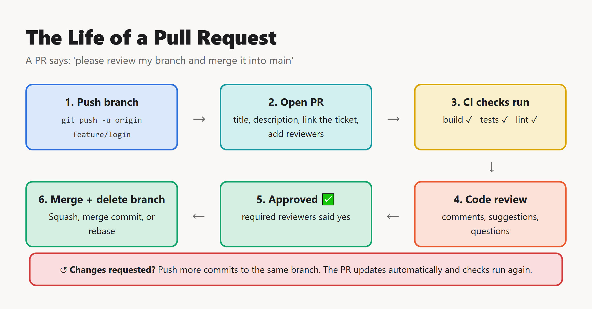

### 30.1 Open your first PR

```bash
git switch -c docs/add-contact-info
echo "Contact: devops@example.com" >> README.md
git commit -am "docs: add contact info"
git push -u origin docs/add-contact-info
```

Git prints a link: `Create a pull request for 'docs/add-contact-info' on GitHub by visiting: https://github.com/...`. Open it, fill in the description, click **Create pull request**.

Or with the GitHub CLI:

```bash
gh pr create --title "docs: add contact info" --body "Adds the team email to the README"
gh pr list
gh pr checkout 42        # check out a teammate's PR locally to test it
gh pr merge 42 --squash --delete-branch
```

### 30.2 What makes a great PR

| Do ✅ | Don't ❌ |
|-------|---------|
| Small: under ~400 lines changed | 3,000-line "big bang" PRs |
| One purpose | Feature + refactor + formatting mixed |
| Title and description explain **why** | Empty description |
| Link the ticket: `Closes #42` | No context |
| Screenshots for UI changes | "See code" |
| Open as **Draft** early for feedback | Surprise reviewers on Friday evening |

A ready PR template is in [`examples/pull_request_template.md`](examples/pull_request_template.md). Put it at `.github/pull_request_template.md`.

### 30.3 Forks: contributing to someone else's project

```
Their repo ──fork──▶ Your copy on GitHub ──clone──▶ Your laptop
     ▲                                                   │
     └──────────── Pull Request ◀──── push ──────────────┘
```

```bash
git clone git@github.com:YOU/their-project.git
git remote add upstream https://github.com/THEM/their-project.git
git fetch upstream
git rebase upstream/main     # stay up to date with the original
```

---

## 31. Code Reviews

**What it is:** A teammate reads your changes before they are merged, looking for bugs, security issues, readability and missed edge cases.

**Why DevOps people care:** A reviewer catching `0.0.0.0/0` in a security group or a hard-coded password **before** merge is worth more than any post-incident review.

### 31.1 What reviewers look for

| Area | Questions |
|------|-----------|
| **Correctness** | Does it do what the PR says? Edge cases? |
| **Security** | Secrets? Open ports? Overly wide permissions? Injection? |
| **Tests** | Are there tests? Do they actually test the change? |
| **Readability** | Will someone understand this in 6 months? |
| **Ops impact** | Logs, metrics, rollback plan, config changes, migrations? |
| **Scope** | Does the PR do one thing? |

### 31.2 How to give good review comments

| ❌ Unhelpful | ✅ Helpful |
|-------------|-----------|
| "This is wrong." | "This will fail if `user` is `None` - maybe add a check on line 14?" |
| "Why??" | "What's the reason for the 30s timeout? The LB times out at 15s." |
| "Bad naming" | "nit: `data2` → `retry_config` would make this clearer" |

Prefixes many teams use: **`nit:`** (tiny, optional), **`question:`**, **`suggestion:`**, **`blocking:`**.

> 💡 **Tip:** On GitHub you can write a ```` ```suggestion ```` block in a comment, and the author can apply your fix with one click.

### 31.3 CODEOWNERS: automatic reviewers

A `CODEOWNERS` file says who must review which paths:

```
*                    @your-org/devops-team
/terraform/          @your-org/platform-team
/.github/workflows/  @your-org/devops-team
```

Full example: [`examples/CODEOWNERS`](examples/CODEOWNERS).

---

## 32. Branch Protection Rules

**What it is:** Settings on the platform that **lock important branches** (`main`, `release/*`) so changes can only arrive the safe way.

**Why DevOps people care:** It turns "please don't push to main" from a polite request into a rule the server enforces. It is also required for audits like SOC 2 and ISO 27001.

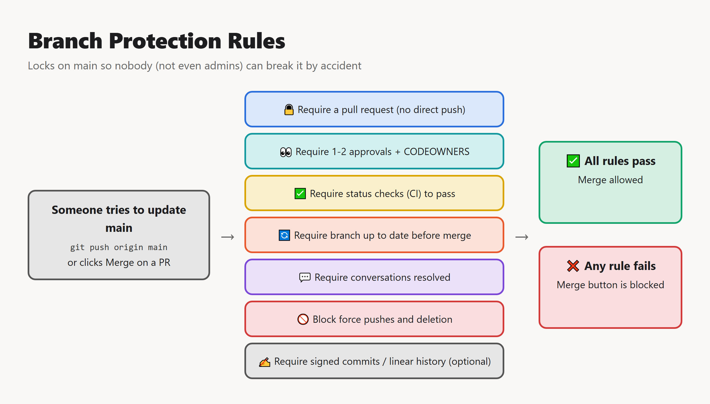

### 32.1 Recommended rules for `main`

| Rule | Why |
|------|-----|
| ✅ Require a pull request before merging | No direct pushes, everything is reviewed |
| ✅ Require at least 1 approval (2 for critical repos) | Four eyes on every change |
| ✅ Dismiss stale approvals when new commits are pushed | Approval matches the final code |
| ✅ Require review from Code Owners | The right experts approve |
| ✅ Require status checks to pass (build, tests, lint, security scan) | Broken code can't merge |
| ✅ Require branches to be up to date | Tests ran against the latest `main` |
| ✅ Require conversation resolution | No ignored comments |
| ✅ Block force pushes | History can't be rewritten |
| ✅ Block deletions | `main` can't be deleted by accident |
| ⭕ Require signed commits | Prove commits really came from the author |
| ⭕ Require linear history | Only squash/rebase merges |
| ⭕ Do not allow bypassing (include administrators) | Rules apply to everyone |

### 32.2 Where to find it

| Platform | Location |
|----------|----------|
| **GitHub** | Repo → Settings → **Rules → Rulesets** (or classic **Branches → Branch protection rules**) |
| **GitLab** | Project → Settings → Repository → **Protected branches** + Merge requests → **Merge checks / Approval rules** |
| **Bitbucket** | Repository settings → **Branch restrictions** + **Merge checks** |

### 32.3 Try it

1. Create a repo on GitHub with a README.
2. Settings → Rules → Rulesets → **New branch ruleset**, target `main`.
3. Enable **Require a pull request**, **Block force pushes**, **Restrict deletions**.
4. On your laptop try:

```bash
echo "direct" >> README.md && git commit -am "direct push" && git push
# remote: error: GH013: Repository rule violations found for refs/heads/main.
# remote: - Changes must be made through a pull request.
```

It worked: `main` is protected. 🎉

---

# PART 5: Practice

---

## 33. The Daily Git Workflow

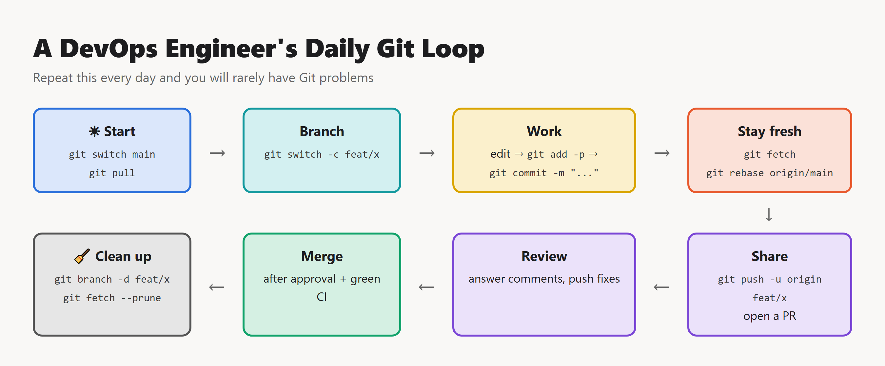

```bash
# ☀ Morning
git switch main
git pull

# Start work
git switch -c feature/DEV-210-health-check

# Work in small steps
git add -p
git commit -m "feat(api): add /health endpoint"

# Stay up to date (at least daily)
git fetch origin
git rebase origin/main

# Share
git push -u origin feature/DEV-210-health-check
# open a PR, address review comments, push more commits

# After merge: clean up
git switch main
git pull
git branch -d feature/DEV-210-health-check
git fetch --prune
```

### 33.1 Handy aliases

```bash
git config --global alias.st "status -s"
git config --global alias.co switch
git config --global alias.lg "log --oneline --graph --all --decorate"
git config --global alias.last "log -1 HEAD --stat"
git config --global alias.undo "reset --soft HEAD~1"
```

Now `git lg` draws the whole branch tree.

---

## 34. Practice Labs

Do these in order in a scratch folder. Each takes 5-15 minutes. ✅ = what you should see at the end.

### Lab 1: First repository

```bash
mkdir git-lab && cd git-lab && git init
echo "Hello Git" > hello.txt
git status
git add hello.txt
git commit -m "Add hello.txt"
git log --oneline
```

✅ One commit in the log.

### Lab 2: The staging area

1. Change `hello.txt` and create `world.txt`.
2. Stage **only** `world.txt` and commit it.
3. Run `git status` - `hello.txt` should still be modified.
4. Run `git diff` to see the change, then `git restore hello.txt` to throw it away.

✅ `git status` says "nothing to commit, working tree clean".

### Lab 3: Push to GitHub

1. Create an empty repo on GitHub called `git-lab`.
2. `git remote add origin ...`, `git push -u origin main`.
3. Edit `hello.txt` **on the GitHub website** and commit there.
4. Locally: `git fetch`, `git log main..origin/main`, then `git pull`.

✅ Your local file has the change made on the website.

### Lab 4: Branch and merge

```bash
git switch -c feature/colors
echo "red" > colors.txt && git add . && git commit -m "Add colors"
echo "blue" >> colors.txt && git commit -am "Add blue"
git switch main
git merge feature/colors
git log --oneline --graph --all
git branch -d feature/colors
```

✅ A fast-forward merge (no merge commit). Now repeat but make a commit on `main` before merging - you'll get a merge commit.

### Lab 5: Create and fix a conflict

Follow [section 17.1](#171-create-a-conflict-on-purpose-try-it) exactly. Then try it again and use `git merge --abort` instead.

✅ You fixed a conflict and saw the merge commit in `git log --graph`.

### Lab 6: Rebase vs merge

1. Create `feature/a` from `main`, make 2 commits.
2. On `main`, make 1 commit.
3. Copy the folder (`cp -r git-lab git-lab-copy`).
4. In one folder: `git merge`. In the other: `git rebase main` on the feature branch, then fast-forward merge.
5. Compare `git log --oneline --graph` in both.

✅ One graph has a "diamond", the other is a straight line.

### Lab 7: Stash and cherry-pick

1. Make an uncommitted change. `git stash`. Switch branch. `git stash pop`.
2. Make a commit on `feature/x`. Switch to `main`. `git cherry-pick -x <hash>`.

✅ The commit exists on both branches with different hashes.

### Lab 8: Undo everything

1. Make 3 commits.
2. `git reset --hard HEAD~3` (they're "gone").
3. Use `git reflog` to find and restore them.
4. Push, then undo one commit **safely** with `git revert`.

✅ History shows a "Revert ..." commit.

### Lab 9: Tags and releases

```bash
git tag -a v0.1.0 -m "First release"
git push origin v0.1.0
```

On GitHub: Releases → Draft a new release → choose `v0.1.0` → **Generate release notes**.

✅ A release page with notes.

### Lab 10: .gitignore and hooks

1. Create `.env` and `debug.log`. Add a `.gitignore` so `git status` doesn't show them.
2. Install [`examples/hooks/pre-commit`](examples/hooks/pre-commit) and try to `git add -f .env` + commit.

✅ The commit is blocked by the hook.

### Lab 11: The full team flow

1. Protect `main` (section 32.3).
2. Create a branch, push it, open a PR with the template.
3. Add a simple GitHub Actions check:

```yaml
# .github/workflows/ci.yml
name: CI
on: [pull_request]
jobs:
  check:
    runs-on: ubuntu-latest
    steps:
      - uses: actions/checkout@v4
      - run: echo "Tests would run here" && test -f README.md
```

4. Make it a **required status check**. Merge with **Squash and merge**. Delete the branch.

✅ You just did exactly what DevOps teams do every day. 🎉

---

## 35. Cheat Sheet

### Setup

| Command | Does |
|---------|------|
| `git config --global user.name "Name"` | Set your name |
| `git config --global user.email "e@x.com"` | Set your email |
| `git init` | New repo in current folder |
| `git clone <url>` | Copy a remote repo |

### Everyday

| Command | Does |
|---------|------|
| `git status` / `git status -s` | What changed |
| `git add <file>` / `git add -p` | Stage changes |
| `git commit -m "msg"` | Save a snapshot |
| `git log --oneline --graph --all` | See history |
| `git diff` / `git diff --staged` | See unstaged / staged changes |
| `git push` / `git pull` | Send / receive commits |
| `git fetch --prune` | Download without merging, clean deleted branches |

### Branches

| Command | Does |
|---------|------|
| `git switch -c <name>` | Create and switch |
| `git switch <name>` | Switch |
| `git branch -a` | List all branches |
| `git branch -d <name>` | Delete merged branch |
| `git merge <branch>` | Merge into current |
| `git rebase <branch>` | Replay current branch on top of another |
| `git cherry-pick -x <hash>` | Copy one commit |
| `git stash` / `git stash pop` | Shelve / restore uncommitted work |

### Undo

| Command | Does |
|---------|------|
| `git restore <file>` | Discard unstaged edits |
| `git restore --staged <file>` | Unstage |
| `git commit --amend` | Fix last commit (not pushed) |
| `git reset --soft HEAD~1` | Undo last commit, keep changes staged |
| `git reset --hard HEAD~1` | Undo last commit and delete changes ⚠️ |
| `git revert <hash>` | Safely undo a pushed commit |
| `git reflog` | Find "lost" commits |
| `git merge --abort` / `git rebase --abort` | Cancel |

### Tags and remotes

| Command | Does |
|---------|------|
| `git tag -a v1.0.0 -m "msg"` | Annotated tag |
| `git push origin v1.0.0` / `--tags` | Push tag(s) |
| `git remote -v` | List remotes |
| `git remote set-url origin <url>` | Change remote URL |
| `git push --force-with-lease` | Safer force push (own branches only) |

---

## 36. Interview Questions

<details>
<summary><b>1. What is the difference between Git and GitHub?</b></summary>

Git is a distributed version control **tool** that runs on your machine. GitHub is a **hosting platform** for Git repositories that adds pull requests, issues, CI/CD (Actions) and access control. GitLab and Bitbucket are alternatives to GitHub.
</details>

<details>
<summary><b>2. Explain the working directory, staging area and repository.</b></summary>

The working directory holds the files you edit. `git add` moves chosen changes to the staging area (index). `git commit` saves the staged snapshot permanently in the local repository (`.git`). `git push` sends commits to a remote.
</details>

<details>
<summary><b>3. git fetch vs git pull?</b></summary>

`fetch` downloads new commits and updates remote-tracking branches (`origin/main`) without touching your work. `pull` = `fetch` + `merge` (or `rebase` with `--rebase`) into your current branch.
</details>

<details>
<summary><b>4. Merge vs rebase - when would you use each?</b></summary>

Merge preserves true history and is safe on shared branches; it creates a merge commit when histories diverged. Rebase rewrites your commits on top of another branch for a linear history. Use rebase to update your own local/feature branch before a PR; use merge (or the PR merge button) to integrate into shared branches. Never rebase public history.
</details>

<details>
<summary><b>5. git reset vs git revert?</b></summary>

`reset` moves the branch pointer back and rewrites history - for local, unpushed commits. `revert` creates a new commit that undoes a previous one - safe for shared/pushed history, e.g. rolling back a bad deploy on `main`.
</details>

<details>
<summary><b>6. What are the three modes of git reset?</b></summary>

`--soft` keeps changes staged, `--mixed` (default) keeps changes in the working directory unstaged, `--hard` discards changes completely.
</details>

<details>
<summary><b>7. What is a fast-forward merge?</b></summary>

When the target branch has no new commits since the feature branched off, Git simply moves the target pointer forward to the feature's tip. No merge commit is created. `--no-ff` forces a merge commit anyway.
</details>

<details>
<summary><b>8. How do you resolve a merge conflict?</b></summary>

Run `git status` to find conflicted files, open each, choose the correct content between `<<<<<<<`, `=======`, `>>>>>>>` and remove the markers, `git add` the file, then `git commit` (or `git rebase --continue`). `git merge --abort` cancels.
</details>

<details>
<summary><b>9. What is git cherry-pick used for?</b></summary>

Applying a specific commit from one branch onto another, e.g. backporting a bug fix to a release branch without merging unrelated features. Use `-x` to record the source commit.
</details>

<details>
<summary><b>10. What is git stash?</b></summary>

It temporarily shelves uncommitted changes so you get a clean working directory, e.g. to switch branches for an urgent fix. Restore with `git stash pop` or `apply`. Use `-u` to include untracked files.
</details>

<details>
<summary><b>11. Compare GitFlow, GitHub Flow and trunk-based development.</b></summary>

GitFlow: `main` + `develop` + feature/release/hotfix branches; suited to scheduled, versioned releases and multiple supported versions. GitHub Flow: `main` always deployable, short feature branches + PRs, deploy after merge; simple and CI/CD-friendly. Trunk-based: everyone integrates into `main` at least daily with very short or no branches, relies on strong CI and feature flags; best for high-frequency delivery.
</details>

<details>
<summary><b>12. What is semantic versioning?</b></summary>

`MAJOR.MINOR.PATCH`. MAJOR for breaking changes, MINOR for backward-compatible features, PATCH for backward-compatible bug fixes. Pre-releases use suffixes like `-rc.1`.
</details>

<details>
<summary><b>13. Lightweight vs annotated tags?</b></summary>

A lightweight tag is just a named pointer to a commit. An annotated tag (`-a`) is a full Git object with tagger, date, message and optional GPG signature - use it for releases. Tags must be pushed explicitly.
</details>

<details>
<summary><b>14. You committed a secret and pushed it. What do you do?</b></summary>

1) **Rotate/revoke the secret immediately** - assume it is compromised. 2) Remove it from the code and add the file to `.gitignore`. 3) If required, purge it from history with `git filter-repo` or BFG and force push, and ask collaborators to re-clone. 4) Add prevention: pre-commit hooks (gitleaks), platform secret scanning and push protection.
</details>

<details>
<summary><b>15. What are Git hooks? Give examples.</b></summary>

Scripts Git runs automatically at points in its workflow. Client-side: `pre-commit` (lint, secret scan), `commit-msg` (message format), `pre-push` (tests). Server-side: `pre-receive`, `post-receive` (enforce policy, trigger deploys). Client hooks aren't cloned and can be bypassed with `--no-verify`, so enforce critical rules in CI/branch protection.
</details>

<details>
<summary><b>16. What branch protection rules would you set on main?</b></summary>

Require PRs, at least 1-2 approvals, code-owner review, passing required status checks, up-to-date branches, resolved conversations; block force pushes and deletion; optionally require signed commits and linear history, and don't allow admins to bypass.
</details>

<details>
<summary><b>17. How do you recover a commit after git reset --hard?</b></summary>

`git reflog` shows where HEAD has been. Find the commit hash and run `git reset --hard <hash>` or `git switch -c recovered <hash>`.
</details>

<details>
<summary><b>18. What is HEAD and what is a detached HEAD?</b></summary>

HEAD points to the currently checked-out branch (which points to a commit). Detached HEAD means HEAD points directly to a commit, not a branch; new commits there aren't on any branch unless you create one with `git switch -c`.
</details>

<details>
<summary><b>19. What does git bisect do?</b></summary>

Binary search through history to find the commit that introduced a bug: `git bisect start`, `git bisect bad`, `git bisect good <hash>`, then test each commit Git checks out and mark it good/bad until it finds the culprit. `git bisect reset` to finish.
</details>

<details>
<summary><b>20. Why should pull requests be small?</b></summary>

Small PRs get reviewed faster and more thoroughly, cause fewer merge conflicts, are easier to test and roll back, and keep CI feedback quick - all key DevOps goals (lead time, change failure rate, MTTR).
</details>

---

## 37. Reference

**Official docs**

- [Pro Git book (free)](https://git-scm.com/book/en/v2) - the best Git book, free online
- [Git reference manual](https://git-scm.com/docs)
- [Semantic Versioning 2.0.0](https://semver.org)
- [Conventional Commits](https://www.conventionalcommits.org)

**Platforms**

- [GitHub Docs](https://docs.github.com) - [About protected branches](https://docs.github.com/en/repositories/configuring-branches-and-merges-in-your-repository/managing-protected-branches/about-protected-branches)
- [GitLab Docs](https://docs.gitlab.com) - [Protected branches](https://docs.gitlab.com/ee/user/project/repository/branches/protected.html)
- [Bitbucket Docs](https://support.atlassian.com/bitbucket-cloud/)

**Strategies**

- [A successful Git branching model (GitFlow)](https://nvie.com/posts/a-successful-git-branching-model/)
- [GitHub Flow](https://docs.github.com/en/get-started/using-github/github-flow)
- [trunkbaseddevelopment.com](https://trunkbaseddevelopment.com)

**Practice**

- [Learn Git Branching (interactive, visual)](https://learngitbranching.js.org) ⭐
- [Oh My Git! (game)](https://ohmygit.org)
- [GitHub Skills](https://skills.github.com)

**Tools**

- [pre-commit](https://pre-commit.com) · [gitleaks](https://github.com/gitleaks/gitleaks) · [GitHub CLI](https://cli.github.com) · [git-filter-repo](https://github.com/newren/git-filter-repo)

---

### 📁 What's in this repo

```
.
├── README.md                      ← this guide
├── images/                        ← all diagrams used in the guide
└── examples/
    ├── hooks/
    │   ├── pre-commit             ← blocks secrets and large files
    │   └── commit-msg             ← enforces Conventional Commits
    ├── sample.gitignore           ← starter .gitignore for DevOps projects
    ├── pull_request_template.md   ← copy to .github/
    └── CODEOWNERS                 ← copy to .github/
```

⭐ If this guide helped you, star the repo and share it with someone starting their DevOps journey.
